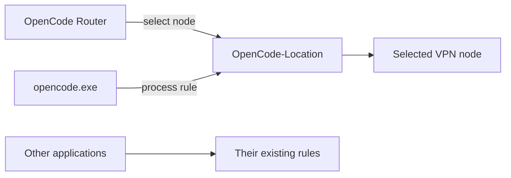

<p align="center"></p>
<h1 align="center">OpenCode Router</h1>
<p align="center"><strong>A dedicated route for OpenCode, controlled from a window or the system tray.</strong></p>
<p align="center">Windows · Clash Verge Rev · PowerShell 7 · PySide6</p>
<p align="center"><a href="README.md">Русский</a> · <strong>English</strong></p>
<p align="center">
  <a href="https://github.com/Frommer-droid/OpenCodeRouter/releases/latest">Download</a> ·
  <a href="#quick-start">Quick start</a> ·
  <a href="docs/USAGE.md">User guide (RU)</a>
</p>

OpenCode Router selects a VPN node for `opencode.exe` through Clash Verge Rev in TUN mode. Its desktop interface shows the current location, external IPv4, API reachability and latency. It controls the dedicated `OpenCode-Location` group while preserving the ordinary VPN group's selection.

> **Before you start:** configure Clash Verge Rev with TUN, an `OpenCode-Location` selector, an `opencode.exe` process rule and a diagnostic HTTP listener. The Router installer does not create this integration. This tool manages an existing Clash configuration; it is not a standalone VPN client.

## Features

- **Select a location** and verify the selected route.
- **Find a different IP** by checking nodes sequentially for a working, different IPv4.
- **Exclude Russia** from available locations and selection using country names, the flag and RU/RUS codes.
- **Compare nodes** using cached results in a sortable table.
- **Monitor the current route** every five minutes while the application is running.
- **Use the system tray** to hide the window, receive notifications and reopen it.
- **Automate through PowerShell** with structured JSON output.



Higher-priority domain rules still apply. The diagnostic listener tests the selected group directly and does not exercise those special domain rules.

## Quick start

### 1. Prepare the environment

Follow the [Clash Verge Rev / TUN setup guide](docs/CLASH_SETUP.en.md) with a minimal credential-free YAML fragment.

| Requirement | Purpose |
| --- | --- |
| Windows | GUI, system tray and Windows named pipe |
| Clash Verge Rev with TUN enabled | Traffic routing |
| PowerShell 7 (`pwsh`) | Router engine, including the desktop version |
| Existing integration | `OpenCode-Location` selector and listener at `127.0.0.1:7900` |

The default controller transport is the `verge-mihomo` named pipe. See [the configuration example](OpenCodeRouter.config.example.json).


### 2. Install

Download the `.exe` installer from the [latest OpenCode Router release](https://github.com/Frommer-droid/OpenCodeRouter/releases/latest) and run it.

The installer includes Python and PySide6. Install PowerShell 7 and Clash Verge Rev separately.

### 3. Check the route

Open Router and refresh its status. Select a node and choose **«Переключить» (Switch)**. **«Другой IP» (Different IP)** finds the next working location with a different IPv4. The current interface uses Russian labels.

Closing the window hides it in the tray. Choose **«Выход» (Exit)** from the tray menu to stop the application.

<details>
<summary><strong>Run the GUI from source</strong></summary>

Install Git and Python 3.12+ in addition to the requirements above.

```powershell
git clone https://github.com/Frommer-droid/OpenCodeRouter.git
cd OpenCodeRouter
py -3.12 -m venv .venv
.\.venv\Scripts\python.exe -m pip install -e ".[dev]"
& ".\OpenCode Router-run.cmd"
```

Run these commands from the clone root. Dependencies belong in the project's `.venv`.

</details>

## Command line

With the Clash integration ready, run from the project directory:

```powershell
pwsh -NoProfile -File .\OpenCodeRouter.ps1 status
pwsh -NoProfile -File .\OpenCodeRouter.ps1 list
pwsh -NoProfile -File .\OpenCodeRouter.ps1 status -Json
```

| Command | Behavior |
| --- | --- |
| `status`, `check` | Check the selected route |
| `list` | Show available names and cached results |
| `scan` | Test allowed nodes, then restore the original selection |
| `use "node name"` | Switch and verify; restore on failure |
| `test "node name"` | Test temporarily, then restore |
| `auto` | Select a working node using latency, preferences and cooldown |
| `auto -DifferentIp` | Find a working node with a different IPv4 |
| `menu` | Open the interactive CLI menu |

Copy exact node names from `list`, including spaces and emoji. The CLI requires PowerShell 7, not Python. Exit codes: `0` success, `2` failed health check, `1` command or switching error.

## Configuration and limitations

- First run creates a local `OpenCodeRouter.config.json` from the example. The controller secret is read from the local Clash configuration.
- API checks measure network reachability, not whether an authenticated model request will succeed.
- A full scan temporarily switches OpenCode's route. Run it between active requests.
- Committed route changes close old OpenCode connections in the dedicated group. The OpenCode process remains running.
- If the controller becomes unavailable, restoring the original route may be impossible.

## Documentation

- [Detailed user guide (Russian)](docs/USAGE.md)
- [Development and build documentation (Russian / English)](DEVELOPER.md)
- [Release notes (Russian)](RELEASE_NOTES.md)
- [Disable the integration and restore settings (Russian / English)](ROLLBACK.md)
- [Safe use: secrets and local controller access](SECURITY.md)

## License

OpenCode Router source code is licensed under the [MIT License](LICENSE). Third-party components retain their own licenses; see [THIRD_PARTY_NOTICES.md](THIRD_PARTY_NOTICES.md).

Third-party terms: [notices](THIRD_PARTY_NOTICES.md), [Qt / PySide6](QT_PYSIDE6_COMPLIANCE.md), [source access](SOURCE_CODE_ACCESS.md).

---

Maintained by [Frommer-droid](https://github.com/Frommer-droid). This is an independent project, not an official OpenCode or Clash Verge Rev component.
