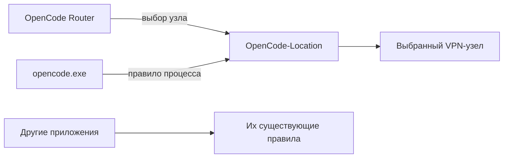

<p align="center">
  
</p>
<h1 align="center">OpenCode Router</h1>
<p align="center"><strong>Отдельный маршрут для OpenCode. Управление из окна и системного трея.</strong></p>
<p align="center">Windows · Clash Verge Rev · PowerShell 7 · PySide6</p>
<p align="center"><strong>Русский</strong> · <a href="README.en.md">English</a></p>
<p align="center">
  <a href="https://github.com/Frommer-droid/OpenCodeRouter/releases/latest">Скачать</a> ·
  <a href="#быстрый-старт">Быстрый старт</a> ·
  <a href="docs/USAGE.md">Руководство</a>
</p>

OpenCode Router выбирает VPN-узел для `opencode.exe` через Clash Verge Rev в режиме TUN. В окне видны текущая локация, внешний IPv4, доступность API и задержка. Утилита управляет выделенной группой `OpenCode-Location`, сохраняя выбор обычной VPN-группы для остальных приложений.

> **Перед запуском:** нужен настроенный Clash Verge Rev с TUN, группой `OpenCode-Location`, правилом для `opencode.exe` и диагностическим HTTP-listener. Установщик Router не создаёт эту интеграцию автоматически. Это инструмент для существующей конфигурации Clash, а не самостоятельный VPN-клиент.

## Что умеет

- **Выбирать локацию** — переключать узел и проверять результат.
- **Находить другой IP** — последовательно искать рабочий узел с новым IPv4.
- **Исключать Россию** — скрывать российские локации по названию, флагу и кодам RU/RUS и пропускать их при выборе.
- **Сравнивать узлы** — сохранять результаты проверок в сортируемой таблице.
- **Следить за маршрутом** — проверять текущий узел каждые пять минут, пока приложение работает.
- **Работать в трее** — скрывать окно, показывать уведомления и возвращаться по клику.
- **Управляться из CLI** — получать статус и результаты в JSON.



Специальные доменные правила с более высоким приоритетом продолжают действовать. Подробнее — [границы маршрута](docs/USAGE.md#границы-маршрута).

## Быстрый старт

### 1. Подготовь окружение

Пошаговая [настройка Clash Verge Rev и TUN](docs/CLASH_SETUP.md) с минимальным обезличенным YAML-фрагментом.

| Компонент | Для чего нужен |
| --- | --- |
| Windows | GUI, системный трей и Windows named pipe |
| Clash Verge Rev с включённым TUN | Маршрутизация трафика |
| PowerShell 7 (`pwsh`) | Движок Router, в том числе при запуске GUI |
| Настроенная интеграция | Группа `OpenCode-Location` и listener `127.0.0.1:7900` |

Контроллер по умолчанию доступен через named pipe `verge-mihomo`. Шаблон настроек — [OpenCodeRouter.config.example.json](OpenCodeRouter.config.example.json).


### 2. Установи приложение

Скачай установщик `.exe` со страницы [последней версии OpenCode Router](https://github.com/Frommer-droid/OpenCodeRouter/releases/latest) и запусти его.

Python и PySide6 входят в готовую поставку. PowerShell 7 и Clash Verge Rev устанавливаются отдельно.

### 3. Проверь маршрут

Запусти Router и обнови статус. Выбери узел в таблице и нажми **«Переключить»**. **«Другой IP»** ищет следующую рабочую локацию с другим IPv4.

Крестик скрывает окно в трей. Для завершения выбери **«Выход»** в меню значка.

<details>
<summary><strong>Запуск GUI из исходников</strong></summary>

Нужны Git и Python 3.12+ в дополнение к требованиям выше.

```powershell
git clone https://github.com/Frommer-droid/OpenCodeRouter.git
cd OpenCodeRouter
py -3.12 -m venv .venv
.\.venv\Scripts\python.exe -m pip install -e ".[dev]"
& ".\OpenCode Router-run.cmd"
```

Команды выполняются из корня клона. Зависимости устанавливаются в проектную `.venv`.

</details>

## Командная строка

Из папки проекта, при подготовленной интеграции Clash:

```powershell
# Текущий маршрут и проверка доступности
pwsh -NoProfile -File .\OpenCodeRouter.ps1 status

# Имена узлов и сохранённые результаты
pwsh -NoProfile -File .\OpenCodeRouter.ps1 list

# Статус в JSON для автоматизации
pwsh -NoProfile -File .\OpenCodeRouter.ps1 status -Json
```

Все команды, переключение и временные проверки описаны в [руководстве](docs/USAGE.md#команды). CLI не требует Python.

## Настройки и ограничения

- При первом запуске локальный `OpenCodeRouter.config.json` создаётся из примера. Секрет контроллера читается из локального конфига Clash.
- Проверка API оценивает сетевую доступность. Она не подтверждает, что запрос с твоим API-ключом будет успешен.
- Полный тест временно переключает маршрут OpenCode. Запускай его между активными запросами.
- После окончательной смены закрываются старые соединения OpenCode в выделенной группе; сам процесс OpenCode продолжает работать.
- Если контроллер недоступен, восстановить маршрут автоматически может быть невозможно.

## Документация

| Документ | Что внутри |
| --- | --- |
| [Руководство](docs/USAGE.md) | GUI, команды, диагностика и настройки |
| [Разработка](DEVELOPER.md) | Архитектура, сборка и тесты |
| [Изменения версии](RELEASE_NOTES.md) | Что изменилось в релизе |
| [Откат](ROLLBACK.md) | Отключение интеграции и восстановление настроек |
| [Безопасное использование](SECURITY.md) | Хранение секретов и защита локального контроллера |

## Лицензия

Исходный код OpenCode Router распространяется под лицензией [MIT](LICENSE). Лицензии сторонних компонентов указаны в [THIRD_PARTY_NOTICES.md](THIRD_PARTY_NOTICES.md).

Условия сторонних компонентов: [THIRD_PARTY_NOTICES.md](THIRD_PARTY_NOTICES.md), [Qt / PySide6](QT_PYSIDE6_COMPLIANCE.md), [доступ к исходникам](SOURCE_CODE_ACCESS.md).

---

Разработчик: [Frommer-droid](https://github.com/Frommer-droid). OpenCode Router — отдельный проект, не официальный компонент OpenCode или Clash Verge Rev.
